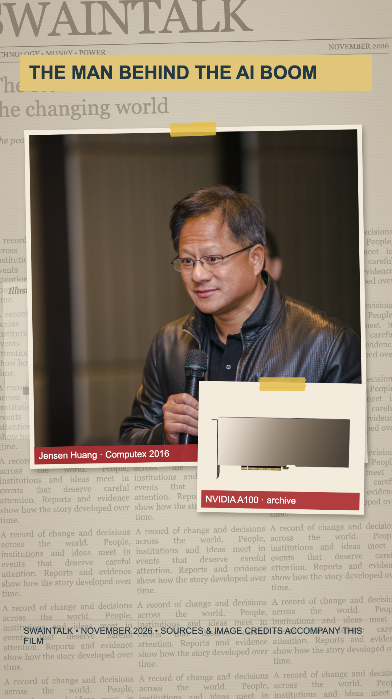
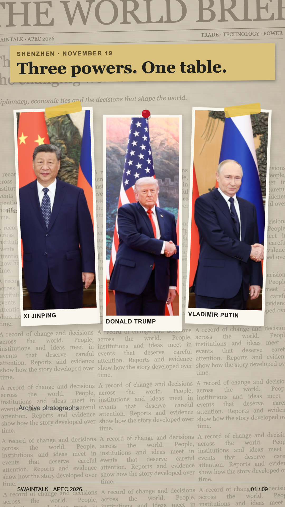

# Newspaper Video

把文稿与证据做成可编辑的 9:16 报纸拼贴讲解视频。此仓库同时是 Agent Skill 和 Remotion 工程模板；适用于 Codex，并提供 Claude Code、Claude 网页/Cowork 与 WorkBuddy 的安装入口。

[20 秒静音样片](assets/previews/style-demo.mp4) · [样例画面](assets/previews/style-preview.png) · [参考风格研究](references/origin-study.md) · [验证记录](references/validation.md)

[下载最新 Skill 安装包](https://github.com/SwainWong/newspaper-video/releases/latest)。

两条实例已更新为 **V4.1 英语审阅版**：英语口播与纯英语字幕，使用经用户试音确认的 VoiceStudio **The Anchor**，节奏较试音放缓。新版以真实照片和来源页面承载内容，先钩子再进入 SwainTalk 品牌过渡，并加入原创 BGM、随动作触发的音效和口播避让混音。

点击下方封面播放。已完成技术解码、旁白转录核对和最终文件抽帧检查；正常速度全片观看、真实听音及作者验收仍待完成。中性模板样片不含配音或频道品牌。

## 两个竖屏制作实例

| 选题 | 视频与资料 | 规格 |
| --- | --- | --- |
| 黄仁勋辞任、美国两党政策争论及 AI 行业影响 |  [播放 MP4](showcase/huang.mp4) · [标题](showcase/huang-title.txt) · [描述](showcase/huang-description.md) · [事实来源](showcase/huang-sources.md) · [图片署名](showcase/huang-image-credits.md) · [字幕](showcase/huang-subtitles.srt) | 2:57.643，1080×1920，30 fps |
| APEC 2026 中美俄深圳会晤前瞻 |  [播放 MP4](showcase/apec.mp4) · [标题](showcase/apec-title.txt) · [描述](showcase/apec-description.md) · [事实来源](showcase/apec-sources.md) · [图片署名](showcase/apec-image-credits.md) · [字幕](showcase/apec-subtitles.srt) | 2:57.534，1080×1920，30 fps |

[视频哈希与审查范围](showcase/manifest.json)。黄仁勋专题将个人关系报道、政治行动记录和未来影响分析分开；APEC 专题是 2026 年 11 月 16 日制作的会前预告，后续正式结果需另行更新。第三方图片的使用范围与未决事项详见各片署名清单，不代表取得全面转载授权。两片的可编辑工作工程及 VO/BGM/SFX 分轨保留在本地 `work/`，仓库提供通用模板和数据接口。

## 安装

| 平台 | 放置或导入 | 调用 |
| --- | --- | --- |
| Codex | 把整个仓库放到 `~/.agents/skills/newspaper-video/`，其中根目录必须有 `SKILL.md` | `$newspaper-video`，或自然语言描述报纸拼贴视频 |
| Claude Code | 把整个仓库放到 `~/.claude/skills/newspaper-video/`；项目内可用 `.claude/skills/newspaper-video/` | `/newspaper-video` |
| Claude 网页 / Cowork | 将包含 `newspaper-video/SKILL.md` 的 ZIP 通过自定义技能入口导入 | 在会话中要求使用该技能；渲染所需 Node、浏览器能力需在所在环境检查 |
| WorkBuddy | 「专家·技能·连接器 → 技能 → 添加技能 → 上传技能」导入同一 ZIP；项目开发模式可放到 `.codebuddy/skills/newspaper-video/` | 在新对话中指定该技能并检查实际加载 |

[平台细节与官方文档](references/platforms.md)。格式适配不等于每个平台已完成端到端测试；已验证范围见上方记录。

## 制作流程（1.4.1）

1. 先确认主语言、独立字幕模式/语言、配音工具（系统声或需安装的 VoiceStudio）。缺项不得启动工程。调研后交中英文对照脚本与图片分镜，用户确认文件版本后才制作。阅读 [完整流程](references/production-workflow.md) 与 [声音模块](references/audio-production.md)。先核实文稿中的事实、角色身份、文件/帖子的来源；画面里让观众看得见谁发布、何时发布和原文关键句。
2. 复制工程：`python3 scripts/project.py create /absolute/path/my-video --brief /absolute/path/review/production-brief.json`。目标目录必须不存在。
3. 在新工程的 `src/timeline.json` 配场景、字幕、图片和音频；将媒体放入该工程的 `public/`。用 `src/theme.json` 调颜色、字幕和部分动画参数。[时间线字段说明](references/timeline.md)。
4. 在新工程运行 `npm ci`、`npm run check`、`python3 validate_timeline.py src/timeline.json`，再回到本仓库通过 `python3 scripts/project.py still /absolute/path/my-video --frame 240` 和 `python3 scripts/project.py render /absolute/path/my-video` 输出静帧、MP4。
5. 按正常速度查看成片并试听，核对字幕、证据停留、配音和素材使用范围。解码通过只说明文件技术上可读。

要求 Python 3、Node 22.12+、npm 和 Chromium/Chrome。工程锁定 Remotion 4.0.540。输出写在新工程的 `out/`，不会写进 Skill。Remotion 和其他第三方依赖遵循各自许可证；仓库不包含参考原片或其截图，也不授权使用第三方新闻图片。

## 模板内容

- `assets/template/src/template.tsx`：报纸舞台、照片卡、标题、字幕、数字、比较条与时间线；`src/editorial.tsx` 提供文件、日程轴和三方关系图。
- `assets/template/src/theme.json`：主要色彩、字幕和入场运动参数。
- `assets/template/public/`：原创中性纸纹、图钉、胶带及示例插图。
- `assets/template/examples/`：不同场景结构示例，含 `editorial-example.json` 和频道片头片尾示例。
- `scripts/preflight.py`：检查语言、字幕、声音选择及脚本批准哈希；不能替代真实用户批准。
- `scripts/project.py`：创建工程、抽帧与渲染；`scripts/package.py`：打包跨平台 Skill。

[参考片分析](references/origin-study.md)列明了目前仍待做成可配置组件的效果。欢迎通过 Issues 报告实际环境、来源展示或视频排版问题。
