# Newspaper Video

把文稿、证据与数据做成可编辑的 9:16 报纸拼贴讲解视频。此仓库同时是 Agent Skill 和 Remotion 工程模板；适用于 Codex，并提供 Claude Code、Claude 网页/Cowork 与 WorkBuddy 的安装入口。

[20 秒静音样片](skills/newspaper-video/assets/previews/style-demo.mp4) · [样例画面](skills/newspaper-video/assets/previews/style-preview.png) · [参考风格研究](skills/newspaper-video/references/origin-study.md) · [验证记录](skills/newspaper-video/references/validation.md)

[下载最新 Skill 安装包](https://github.com/SwainWong/newspaper-video/releases/latest)。

两条实例已更新为 **V6 系列英语审阅版**，采用 Skill 1.6.1 的视觉规范：首秒主体影像、图片与分析同场、明确关系连线、同一原件连续平移缩放。固定 SwainTalk 品牌、英语 The Anchor 口播、纯英语字幕、品牌停顿和有节奏的配乐沿用。

下方 GIF 可在 GitHub README 中直接展示动画。完整 MP4 另提供打开/下载入口；GIF 为无声片段，不代表全片或声音验收。

## 两个竖屏制作实例

### 黄仁勋专题 · V6.1

**2:59.243 · 1080×1920 · 30 fps。** 8 个内容场景中有 6 个包含实质图片；关系图用人物/产品形象标识主体，用带标签的箭头说明关系。主标签和连接词经过手机尺寸复核并放大。

| 人物影像开场 | SEC 原件连续放大、高亮 |
| --- | --- |
| 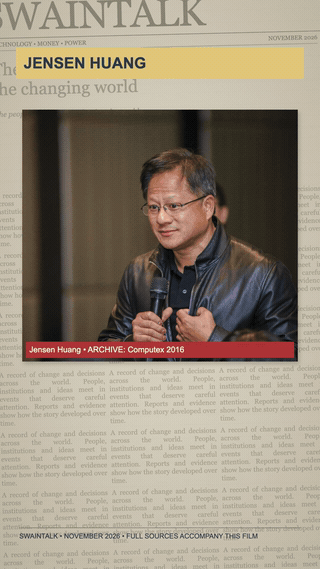 | 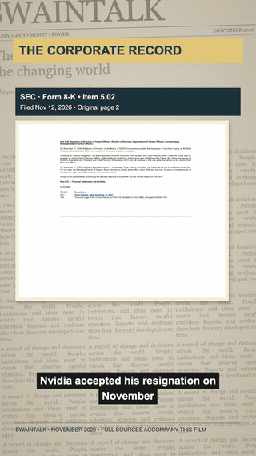 |

| 图片与政策关系 | 产品与供应链关系 |
| --- | --- |
| 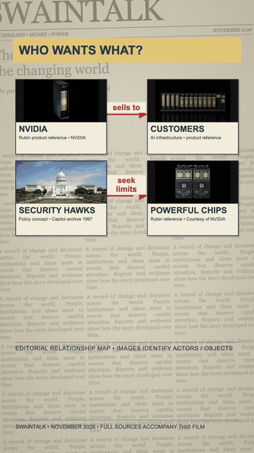 | 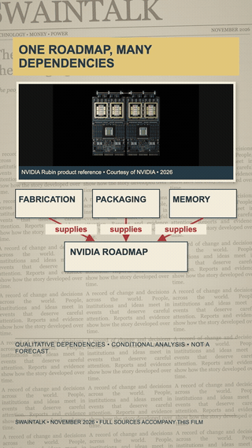 |

[打开／下载完整 MP4](showcase/huang.mp4) · [封面](showcase/huang-cover.png) · [标题](showcase/huang-title.txt) · [描述](showcase/huang-description.md) · [事实来源](showcase/huang-sources.md) · [图片署名](showcase/huang-image-credits.md) · [英语字幕](showcase/huang-subtitles.srt) · [GIF 时间码与哈希](showcase/huang-gifs/manifest.json)

### APEC 专题 · V6

**2:54.912 · 1080×1920 · 30 fps。** 三位领导人照片构成开场；8 个内容场景中有 7 个包含实质图片。外交部与 IMF 原文保留同一原图连续放大；经济分析使用同口径、同刻度的实际 GDP 增长预测数据。

| 三位领导人影像钩子 | 公告全貌到重点 |
| --- | --- |
| 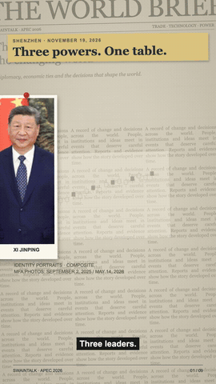 | 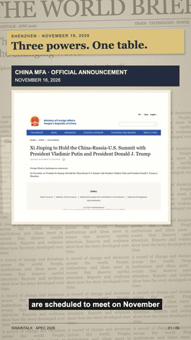 |

| IMF 全貌到预测年份 | 随口播增长的数据条 |
| --- | --- |
| 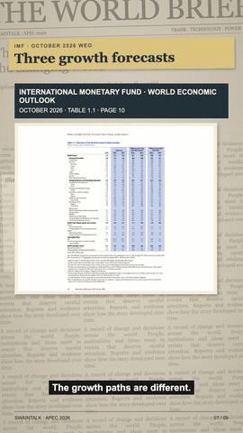 | 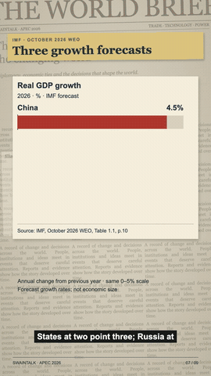 |

雅尔塔到波茨坦，随讲述切换历史影像：

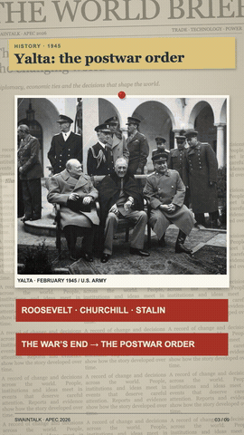

[打开／下载完整 MP4](showcase/apec.mp4) · [封面](showcase/apec-cover.png) · [标题](showcase/apec-title.txt) · [描述](showcase/apec-description.md) · [事实来源](showcase/apec-sources.md) · [图片署名](showcase/apec-image-credits.md) · [英语字幕](showcase/apec-subtitles.srt) · [经济数据](showcase/apec-economy-data.csv) · [GIF 时间码与哈希](showcase/apec-gifs/manifest.json)

[视频哈希与审查范围](showcase/manifest.json)。已完成完整解码、制作记录与实际旁白停顿检查，以及最终文件关键画面和变焦中间帧检查；正常速度全片观看、真实听音及作者验收仍待完成。图片覆盖统计排除品牌段、文档截图、背景和微小水印。

黄仁勋专题将个人关系报道、政治行动记录和未来影响分析分开；APEC 专题是 2026 年 11 月 16 日制作的会前预告，后续正式结果需另行更新。第三方图片使用范围与未决事项见署名清单，不代表取得全面转载授权。可编辑工程及 VO/BGM/SFX 分轨保留在本地 `work/`；仓库提供通用模板和数据接口。

## 安装插件（1.9.0）

源码只维护在 `skills/newspaper-video/`。根目录旧入口为兼容链接；安装缓存是分发副本，不在其中开发。

Codex：`codex plugin marketplace add /absolute/path/newspaper-video`，然后 `codex plugin add newspaper-video@swainwong-newspaper`。发布前可运行 `python3 skills/newspaper-video/scripts/build_plugin.py /outside/source/release` 创建干净的本地市场，再对该路径安装。

Claude Code：`claude plugin marketplace add /absolute/path/newspaper-video`，然后 `claude plugin install newspaper-video@swainwong-newspaper`。调用 `/newspaper-video:newspaper-video`。

WorkBuddy：自定义市场的桌面入口依客户端而定，未作保证。兼容 CodeBuddy CLI 的模式可用 `codebuddy plugin marketplace add /absolute/path/newspaper-video` 及 `codebuddy plugin install newspaper-video@swainwong-newspaper`。不支持市场导入的客户端可运行 `python3 skills/newspaper-video/scripts/package.py /outside/source/newspaper-video.zip`，从技能上传入口导入。平台客户端导入与实际渲染的验证状态分别记录，不把清单兼容当端到端成功。

官方契约：[Claude Code](https://code.claude.com/docs/en/plugins-reference)、[WorkBuddy插件](https://www.codebuddy.cn/docs/workbuddy/From-Beginner-to-Expert-Guide/Function-Description/Plug-In)、[CodeBuddy兼容清单](https://www.workbuddy.ai/docs/zh/cli/plugins-reference)。

## 参考研究与动效模块

输入是批准脚本、真实时码与合法素材；先按语义选择图像、数据、证据或关系画面，加入标题/字幕，检查动作组合，再渲染并看听。输出为可编辑工程、MP4与来源/验收记录，交给用户审阅。

参考研究模块读取5/6/7与截图，产出带来源哈希的[观察记录](skills/newspaper-video/references/origin-study-567.md)，交给动画设计。新增13种设计配方包含分区关系、阶段曲线、检查板、行情线、色层/遮挡、日历翻页等；1.8已全部实现为11个画面组件与2种转场，接入[可执行接口](skills/newspaper-video/references/motion-api.md)。

动画模块读取[逐项合同](skills/newspaper-video/references/motion-contracts.md)，选择输入、适用条件、运动阶段与互斥关系，产出 `motion-plan.json`，交给组合检查。效果的状态、来源和互斥关系在[目录](skills/newspaper-video/references/motion-catalog.json)明确区分。

声音模块以动作时码为输入，将原创paper/tick/whoosh短音或有许可素材绑定到动作，输出独立SFX和混音，交给听审。内置短音是设计候选，尚未做真实听音验收。

组合检查读取动作时段、区域、焦点和声音锚，先运行与渲染器共用的字段校验，再拒绝区域冲突、失配的时间线哈希、遗漏动作与声音记录；完整render会运行 `motion_gate.py --timeline`。它不能代替实际看听。[平台验证记录](skills/newspaper-video/references/platform-validation-20261117.md)区分清单与运行验收。

## 多版式动画与回归（1.9.0）

版式模块接收脚本语义、真实媒体和时间锚，输出16种可编辑组合：斜照片与时间轴、文件与人物、大字年份、照片下方窄比较条、占据主画面的双色比较、中央关键词与图标、教学板和行情图。各子层可独立配置位置、字形、入场及二次移位，交给画面与字幕检查。[版式目录](skills/newspaper-video/references/collage-presets.md) · [完整接口与冲突条件](skills/newspaper-video/references/collage-api.md)。

比较模块分别实现4801与4803的构图。两侧色块带文字从屏幕外移入，两侧落稳后才出现关系徽章；标题可先画轮廓再填色。4806使用分开的短语纸片、钱包和投票箱。声音绑定节点的入场、落稳、填色或关系揭示，输出实际渲染的候选SFX；没有把参考混音中的峰值冒充已识别音效。

回归模块读取参考帧与候选帧，明确坐标变换、裁切和遮罩，把重绘图形与复用照片/纸纹分别计量，输出对照、叠加、差分与哈希报告，交给人工看听。[对齐研究](skills/newspaper-video/references/pixel-reference-study.md) · [像素比较工具](skills/newspaper-video/references/pixel-compare-api.md) · [六组运动与声音设计](skills/newspaper-video/references/reference-av-combinations.md)。16截图中12张已匹配视频前景；4805–4808仅有截图构图依据。字体、纹理和部分几何仍有差异，不声称完全像素一致。

`python3 scripts/collage_demo.py /new/layout-fixture`生成16场景合成工程与绑定时间线的动作计划。配合`node tests/collage_runtime.cjs /new/layout-fixture`检查真实组件；它们不替代节目脚本批准、正常速度观看、真实听音或作者验收。全场拼贴与旧布局互斥；此版本保守地拒绝全场拼贴与全屏转场同时占用，需用独立过渡镜头。

[播放16种版式完整合成样片](showcase/layout-showcase-1.9.mp4)（213.33秒，540×960，静音；全部图像/数据为合成示例）。[哈希与采样范围](showcase/layout-1.9/manifest.json) · [1.9验证记录](skills/newspaper-video/references/validation-1.9.md)。

| 照片下方的窄比较条 | 主画面的双色比较 | 中央短语与投票箱 |
| --- | --- | --- |
|  |  | 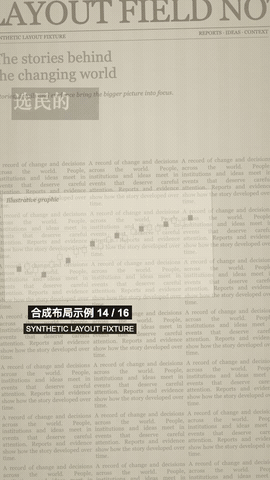 |

## 制作流程（1.9.0）

1. 先确认主语言、独立字幕模式/语言、配音工具（系统声或需安装的 VoiceStudio）。缺项不得启动工程。调研后交中英文对照脚本与图片分镜，用户确认文件版本后才制作。阅读 [完整流程](skills/newspaper-video/references/production-workflow.md) 与 [声音模块](skills/newspaper-video/references/audio-production.md)。先核实文稿中的事实、角色身份、文件/帖子的来源；画面里让观众看得见谁发布、何时发布和原文关键句。
2. 复制工程：`python3 skills/newspaper-video/scripts/project.py create /absolute/path/my-video --brief /absolute/path/review/production-brief.json`。目标目录必须不存在。
3. 按[语义动画规范](skills/newspaper-video/references/semantic-motion.md)设计首秒影像钩子，至少一半内容场景使用实质图片，并结合数据比较和带明确关系标签的连线；原文证据用同一页面连续平移缩放，记录真实声词锚点及素材日期。在新工程的 `src/timeline.json` 配场景、字幕、图形和音频；将媒体放入该工程的 `public/`。用 `src/theme.json` 调颜色、字幕和部分动画参数。[时间线字段说明](skills/newspaper-video/references/timeline.md)。
4. 在新工程运行 `npm ci`、`npm run check`、`python3 validate_timeline.py src/timeline.json`，并完成 `review-plan.json`；完整渲染前运行 `python3 skills/newspaper-video/scripts/review_plan.py /absolute/path/my-video/review-plan.json --require-visual` 检查记录，再回到本仓库通过 `python3 skills/newspaper-video/scripts/project.py still /absolute/path/my-video --frame 240` 和 `python3 skills/newspaper-video/scripts/project.py render /absolute/path/my-video` 输出静帧、MP4。
5. 按正常速度查看成片并试听，核对字幕、证据停留、配音和素材使用范围。解码通过只说明文件技术上可读。

要求 Python 3、Node 22.12+、npm 和 Chromium/Chrome。工程锁定 Remotion 4.0.540。输出写在新工程的 `out/`，不会写进 Skill。Remotion 和其他第三方依赖遵循各自许可证；仓库不包含参考原片或其截图，也不授权使用第三方新闻图片。

## 模板内容

- `assets/template/src/analysis-graphics.tsx`：按声词时码增长的数据条、同源连续变焦/黄笔/摘要、带图片及连接含义的逐步关系图和固定 SwainTalk 品牌组合。`public/brand/` 保留原透明 Logo、字体与许可；其他频道可用通用品牌接口。
- `assets/template/src/template.tsx`：报纸舞台、首帧可见的主体照片卡、标题、字幕、数字、比较条与时间线；`src/editorial.tsx` 提供文件、日程轴和三方关系图。
- `assets/template/src/theme.json`：主要色彩、字幕和入场运动参数。
- `assets/template/public/`：原创中性纸纹、图钉、胶带及示例插图。
- `assets/template/examples/`：不同场景结构示例，含 `editorial-example.json` 和频道片头片尾示例。
- `scripts/review_plan.py`：检查影像场景覆盖、前三秒钩子、连续变焦及关系语义记录，以及语义时间、数据口径、当期素材日期和品牌前后停顿记录；`brand_pause_check.py` 用 ffmpeg 另核实际 VO 分轨的停顿区间；不替代实际看听。
- `scripts/preflight.py`：检查语言、字幕、声音选择及脚本批准哈希；不能替代真实用户批准。
- `scripts/showcase_gifs.py`：从最终成片的3–5段选定窗口生成README动画GIF，并保存来源与产物哈希。
- `scripts/project.py`：创建工程、抽帧与渲染；`scripts/package.py`：打包跨平台 Skill。

[早期参考片分析](skills/newspaper-video/references/origin-study.md)保留历史观察；当前可执行状态以[动效目录](skills/newspaper-video/references/motion-catalog.json)为准。欢迎通过 Issues 报告实际环境、来源展示或视频排版问题。

## 组件预览与开发验证

[打开 77 秒组件样片](showcase/motion-showcase-1.8.mp4)（540×960、30 fps，含原创候选 SFX，无旁白/BGM）。这是合成资料测试，包含 11 个组件和 2 种转场；源片 SHA 与动图窗口见[预览清单](showcase/motion-1.8/manifest.json)。

| 双区关系与色块转场 | 深色教学板分段曲线 |
| --- | --- |
| 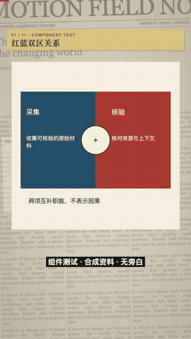 | 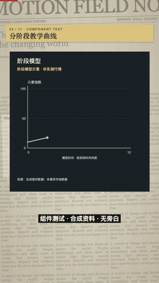 |

| 虹膜转场与日历翻页 | 关键词纸条 |
| --- | --- |
| 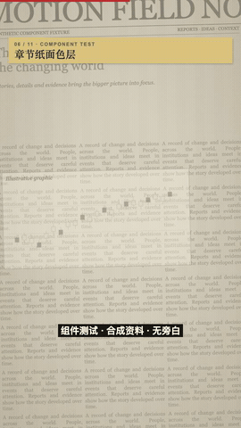 | 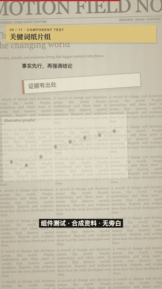 |

32 项 Python 回归、52 组真实组件运行检查、TypeScript、样片与 GIF 完整解码通过；关键画面及切镜帧已抽查。连续观看、真实听音及用户验收尚未完成。

`python3 skills/newspaper-video/scripts/motion_demo.py /new/fixture` 创建明确标记的合成测试工程，包含全部13种效果及SFX；这不是新闻成片，也不代替脚本批准。运行npm ci、npm run check、node scripts/validate-motion.cjs src/timeline.json后可直接用Remotion渲染测试。

源码回归：`python3 -m unittest discover -s tests -v`；有依赖的测试工程上运行 `node tests/motion_runtime.cjs /absolute/fixture` 检查真实组件的输入、时序、终态及转场。新克隆不依赖用户目录配置；Node要求22.12以上。
